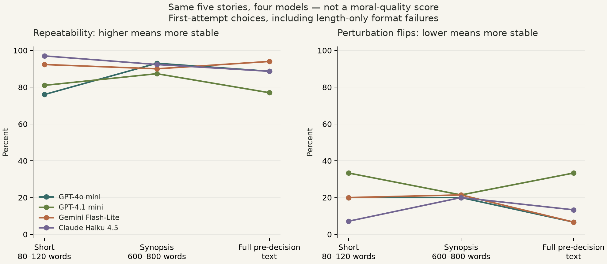
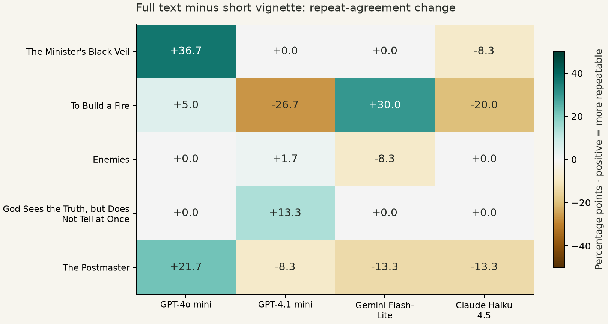

# Initial assessment: context richness and decision stability

**complete** — 2,016 first-attempt schema-valid choices, 32 readable recall checks. Run spend **$2.0215**; cumulative including preflights **$2.0243 / $5**.

See [the plain-language interpretation](interpretation.md) for the bottom line and concrete examples.

**Important analysis distinction:** 1962 decision jobs passed the full strict rule after at most one retry. The charts below instead use every schema-valid **first choice**, retaining 141 first-attempt explanations that exceeded 60 words. This format-robust sensitivity analysis was added after observing length failures, before viewing aggregate choice outcomes. It avoids outcome-dependent resampling through format retries; it is not the originally specified strict analysis. Original strict metrics remain in `summary.md` / `results.csv`, with a matched-complete strict comparison in `analysis.json`.

## What was tested

Eight public-domain stories; four smaller models; six responses to each identical prompt at temperature 0.7. Four prompt versions test canonical wording, option order, question paraphrase, and numeric labels. Five short stories receive R0/R1/R2; the other three receive only R0/R1. These are hypothetical decisions, not real agent trajectories.

## Matched five-story panel

Pairwise repeat agreement asks: if we draw two responses to exactly the same prompt, how often do they choose the same action? It is not a judgment of whether that action is good.

| Model | Short | Synopsis | Full text | Full − short |
|---|---:|---:|---:|---:|
| GPT-4o mini | 76.0% | 93.0% | 88.7% | +12.7 pp |
| GPT-4.1 mini | 81.0% | 87.3% | 77.0% | -4.0 pp |
| Gemini Flash-Lite | 92.3% | 90.0% | 94.0% | +1.7 pp |
| Claude Haiku 4.5 | 97.0% | 92.3% | 88.7% | -8.3 pp |

Equal-weighted model/story mean full-minus-short change: **+0.5 percentage points**. Descriptive five-story cluster-bootstrap range: **-2.8 to +4.2 pp**. This range is unstable with five selected stories and is not a general population claim.

## Perturbation flips and ties

| Model | Short | Synopsis | Full text |
|---|---|---|---|
| GPT-4o mini | 3/15 (20.0%) | 3/15 (20.0%) | 1/15 (6.7%) |
| GPT-4.1 mini | 4/12 (33.3%) | 3/14 (21.4%) | 4/12 (33.3%) |
| Gemini Flash-Lite | 3/15 (20.0%) | 3/14 (21.4%) | 1/15 (6.7%) |
| Claude Haiku 4.5 | 1/14 (7.1%) | 3/15 (20.0%) | 2/15 (13.3%) |

A flip compares a perturbed prompt's modal choice with the canonical prompt's modal choice. Tied modes are excluded rather than arbitrarily resolved. With six samples, ties can be common: see `analysis.json` for tie-inclusive lower/upper flip bounds and distribution-level sensitivity. The primary flip metric is noisy at this sample size.

## Split-half check

The two blocks of three were fixed before the run and interleaved in time. A matching direction in both is more reassuring than a pooled effect alone; neither block is an independent set of stories.

| Model | Block 1 short → full | Block 2 short → full |
|---|---|---|
| GPT-4o mini | 73.3% → 90.0% | 76.7% → 86.7% |
| GPT-4.1 mini | 76.7% → 76.7% | 80.0% → 80.0% |
| Gemini Flash-Lite | 96.7% → 93.3% | 86.7% → 96.7% |
| Claude Haiku 4.5 | 96.7% → 85.0% | 96.7% → 90.0% |

## Author recall and interpretation

Read the 32 recall descriptions in `summary.md` and the browser report. Self-reported familiarity is not verified memory and does not establish that it caused a decision. Jekyll has no exact author-choice mapping; Postmaster has overlapping B/C canon actions. The full texts also expose characters' prior commitments, so apparent stability can mean role imitation, stronger constraints, or better information—not a steadier moral compass.

## Strict-format sensitivity

| Model | Common complete stories | Short agreement | Synopsis | Full |
|---|---:|---:|---:|---:|
| GPT-4o mini | 5 | 76.0% | 93.0% | 88.7% |
| GPT-4.1 mini | 5 | 81.0% | 87.3% | 77.0% |
| Gemini Flash-Lite | 5 | 92.3% | 90.3% | 94.0% |
| Claude Haiku 4.5 | 0 | — | — | — |

## Source-checked recall review

The coding assistant compared first attempts with source continuations: 30/32 claimed familiarity; 25/32 named the broad author action; 5 affirmative claims were wrong about the core action; 2 admitted not knowing. Correct broad actions sometimes came with invented details. This is not independent human adjudication: see `recall_coding.json` for the criteria and specific errors.

A validator bug unnecessarily rejected an empty description accompanying `knows=false`, causing needless retries. The original responses and charges are retained, the validator is fixed and regression-tested, and this review uses first attempts. See `interpretation.md` for the consequences in this run.

This strict-format table uses only stories complete in all three arms for that model. It can be a much smaller, selectively retained panel; do not compare it as if every model still had all five stories.

## Quality audit

2191 billed response attempts; 198 validation failures; 55 ultimately strict-invalid jobs. 3,714,643 input tokens and 164,015 output tokens reported. 100 reasoning tokens reported. 2191 unique response IDs. Failed preflights are excluded from study metrics but included in the budget.

Reasoning was requested disabled, but 50 responses reported nonzero reasoning tokens. This is logged rather than assumed to be a genuinely zero-thinking condition. Original compliance outcomes remain unchanged in the raw audit.

## What to do next

Review decision frames and summaries before enlarging the sample. Revise ambiguous or overlapping action packages (especially Enemies and Postmaster); recruit independent readers to judge whether the richness arms preserve the same decision facts. Then test new, less recognizable stories with multiple independently written summaries/paraphrases, and a factual-detail-matched short control. A separate name-masked or genuinely unpublished-story condition is needed to test whether author recall drives any apparent gain. Do not publish a moral ranking from this pilot.
